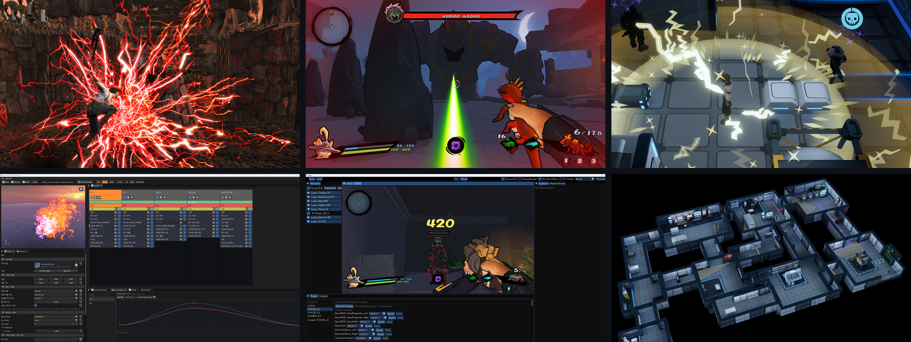
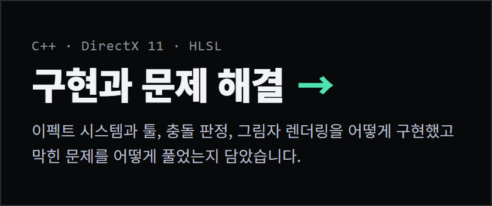
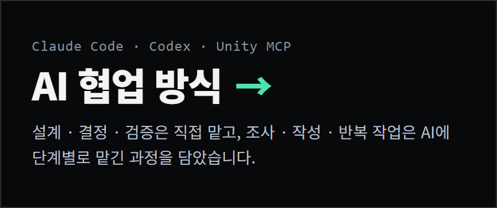

### 김석호 · 게임 클라이언트 프로그래머

C++과 DirectX 11을 주력으로, 프로젝트마다 다른 시스템을 만들고 새 기술을 더해 왔습니다.

 

---

### Projects

| 프로젝트 | 기간 · 규모 | 기술 | 맡은 일 |
|---|---|---|---|
| [**Expedition 33 모작**](https://shkim-33.github.io/cpp-portfolio/#ex) | 2026.05–07 · 8인 | C++20 · DX11 · HLSL Compute | 이펙트 전담: GPU 파티클 런타임, EffectEditor, 전투 VFX |
| [**Destiny Overclock**](https://shkim-33.github.io/cpp-portfolio/#do) | 2026.11 · 9일 · 3인 | Unity 6.3 · C# · URP | 2026 Unity 게임잼 출품, 운·해킹·경보 시스템 |
| [**SinkPoint**](https://shkim-33.github.io/cpp-portfolio/#etc) | 2026.08 · 5일 · 2인 | Unity 6.3 · WebGL | OpenAI Game Builders Seoul 예선, 방향 중력·무중력·그래플 |
| [**Gunfire Reborn 모작**](https://shkim-33.github.io/cpp-portfolio/#gf) | 2026.01–04 · 개인 | C++20 · DX11 · HLSL | 레벨 에디터, 보스 패턴, OBB 충돌, 히트스캔, 그림자 |

그 밖에 Cult of the Lamb 모작(DX9, 4인), Skul 모작(DX11, 개인)은 [사이트](https://shkim-33.github.io/cpp-portfolio/#etc)에 정리했습니다.

### Contact

📧 ksh66020@gmail.com
